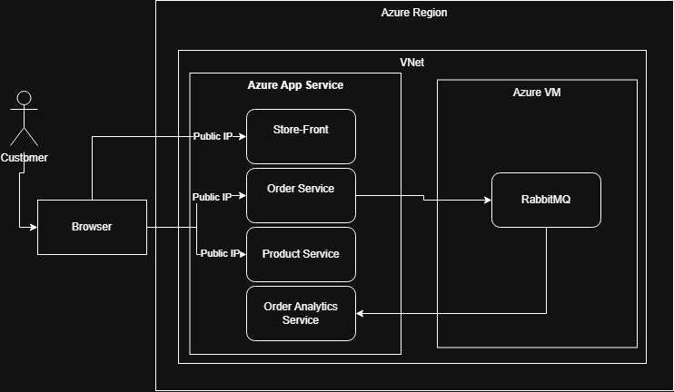

# CST8915 Midterm Project: Extending the Algonquin Pet Store with an Order Analytics Microservice

## Team Members and Tasks

| Member      | Task                                                                                                                                                                 |
| ----------- | -------------------------------------------------------------------------------------------------------------------------------------------------------------------- |
| Kamal Krami | Section 1: Order Analytics Service Section 2: RabbitMQ Consumer Pattern and Justification Section 3: 12-Factor App Compliance Section 4: Local Testing |
| Naol Meherete | Section 5: Azure Deployment                                                                                                                                        |
| Angus Macgillivary | Section 6: System Architecture Diagram Report (README)                                                                                                     |

---

## Video Presentation

🎥 [YouTube link (unlisted)]()

---

## Service Repositories

| Service | Language | Repository |
| --- | --- | --- |
| order-analytics-service (new) | Node.js | [order-analytics-service](https://github.com/kramikamal/order-analytics-service) |
| order-service | Node.js | [order-service-lab2](https://github.com/kramikamal/order-service-lab2) |
| product-service | Python | [product-service-L3P](https://github.com/kramikamal/product-service-L3P) |
| store-front | Vue.js | [store-front-lab2](https://github.com/kramikamal/store-front-lab2) |

---

## Section 1: Order Analytics Service

The Order Analytics Service is the sole consumer of the orders published by the Order Service.  Built with Express.js, it stores all orders and provides analytics such as total revenue, average order value and product sales by quantity.

### API Endpoints
| Method | Endpoint | Description |
| --- | --- | --- |
| GET | `/health` | Service status and RabbitMQ connection |
| GET | `/orders` | List of all consumed orders |
| GET | `/analytics/summary` | Total orders, total revenue, and average order value |
| GET | `/analytics/products` | Orders grouped by product, with count and revenue |
| GET | `/analytics/top-products` | Top 3 products by total quantity sold |

---

## Section 2: RabbitMQ Consumer Pattern and Justification

We employed a push-based pattern with manual acknowledgement from the consumer.  The order analytics service first opens a channel with the RabbitMQ message broker, then registers using `channel.consume()`, causing the RabbitMQ to automatically push messages to the service.  The consumer returns an ACK response **if and only if** the order is stored without issue.  

This setup provides the following advantages:

- **Event-Driven Architecture:** Allows analytics to be updated in real-time, as well as prevents wasted resources from consumer polling.
- **No Lost Orders:** Manual acknowledgement guarantees that messages are deleted from the queue only when the order is correctly stored.  Additionally, the consumer is able to respond with NACK and discard invalid messages.
- **Easy Scalability:** The service can easily be scaled horizontally, adding additional consumers to the broker.  In such a case, the broker would follow the **competing consumer pattern**, distributing messages among available consumers.
---

## Section 3: 12-Factor App Compliance

The application is compliant with the first 4 factors of the 12-factor app model.

### I. Codebase
Each service is maintained in a single GitHub repository, which in turn maintains only that service. 
### II. Dependencies
All dependencies are explicitly declared in the repository's respective dependency file; package.json for the order, order analytics and store front services, and requirements.txt for the product service.
### III. Config
All configurations, including conncetion strings and port numbers, are stored in the environment and referenced using `dotenv` libraries.
### IV. Backing Services
RabbitMQ is treated as an interchangeable resource and is only referenced using a connection string stored in the environment.
---

## Section 4: Local Testing
### Setup
- **RabbitMQ**: Run inside a Docker container (rabbitmq:4.3.6-management)
- 4 services installed and listening on different ports
- Config stored in .env files

### Testing

- Multiple orders placed through store front
- All analytics endpoints tested with Postman
- RabbitMQ queue contents checked to verify message consumption

### Results

- All services communicating correctly
- All orders confirmed to reach the order analytics service
- Order analytics data was correct
- Queue confirmed to be empty

---

## Section 5: Azure Deployment

---

## Section 6: System Architecture Diagram

---

## Challenges and Lessons Learned

> _[Optional: setup problems we had and what we learned.]_

---

## AI Use Disclosure

AI was used to create the boilerplate code for the order analytics service  

---

## References

- [Example](link)